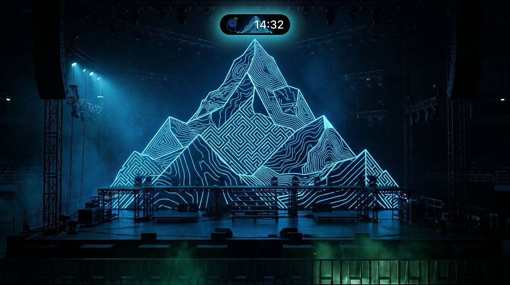

<div align="center">

# مازِی

**جزیرهٔ کوچک ویندوز، برای بچه‌های ماز.**

یک قرص بالای صفحه. آهنگ، نوتیفیکیشن، کپی، فایل، تایمر درس.  
و هر بار که نگاهش می‌کنی، مسیر یادت می‌آید.

[](https://github.com/irariamir/Mazey/releases/latest)
[](https://github.com/irariamir/Mazey/releases)
[](https://github.com/irariamir/Mazey/actions/workflows/build.yml)
[](LICENSE)

[دانلود نصب‌کننده](https://github.com/irariamir/Mazey/releases/latest/download/Mazey-Setup.exe)
&nbsp;·&nbsp;
[نسخهٔ پرتابل](https://github.com/irariamir/Mazey/releases/latest/download/Mazey-Portable.exe)
&nbsp;·&nbsp;
[zip](https://github.com/irariamir/Mazey/releases/latest/download/Mazey-Windows.zip)



</div>

<div dir="rtl">

ماز را در کلاس می‌خوانی. مازِی را روی لپ‌تاپ می‌گذاری.

من دانش‌آموز دوازدهم ریاضی‌ام. ماز برای من قله بود؛ دلم می‌خواست همان قله از سایت بیرون بیاید و بالای صفحه بنشیند. چیزی که از حد یک کلاس فراتر برود، ولی ماز را فراموش نکند.

مازِی را برای [گروه آموزشی ماز](https://biomaze.ir) ساختم. کارگاهش [ARIAMIR](http://ariamir.ct.ws) است.

## چه کار می‌کند

موس را روی قرص بالای صفحه ببر. منو باز می‌شود.

آهنگ در حال پخش همین‌جاست: اسم، کاور، قبلی و بعدی. فیلم و بازی تمام‌صفحه را ول می‌کند.

نوتیفیکیشن یک خط است. بزن، همان چت باز می‌شود.

چیزی کپی کردی، لینک بود باز می‌شود، حساب بود جوابش را می‌دهد، تاریخ بود شمسی و میلادی‌اش را می‌گوید.

فایل را روی جزیره رها کن. تا وقتی لازم داری همان‌جا می‌ماند.

`Ctrl+Alt+N` یک خط یادداشت. اگر بنویسی «۱۰ دقیقه دیگه زیست»، یادش می‌ماند.

رمز می‌سازد، می‌پرسد برای کدام سایت است، با حساب ویندوز قفلش می‌کند.

`Ctrl+Alt+T` دور متن کادر بکش؛ فارسی و انگلیسی. چیزی از دستگاه بیرون نمی‌رود.

تایمر درس تا ته روی صفحه می‌ماند.

دکمهٔ ماز یک جمله می‌گوید و می‌رود.

چشم‌های جزیره پلک می‌زنند. تم پیش‌فرض اورست است؛ تم آریامیر هم هست.

تنظیمات داخل خود جزیره است. پنجرهٔ جدا ندارد.

## نصب

ویندوز ۱۰ یا ۱۱. روی ۱۱ چیزی اضافه لازم نیست.

**[Mazey-Setup.exe](https://github.com/irariamir/Mazey/releases/latest/download/Mazey-Setup.exe)** را بگیر و باز کن. فقط برای همین کاربر نصب می‌شود، رمز ادمین نمی‌خواهد، بعد از نصب خودش می‌آید بالا. از تنظیمات می‌شود گفت با ویندوز باز شود.

ویندوز یک بار SmartScreen را نشان می‌دهد. Run anyway.

اگر نصب نمی‌خواهی: **[Mazey-Portable.exe](https://github.com/irariamir/Mazey/releases/latest/download/Mazey-Portable.exe)**

## حریم خصوصی

مازِی به اینترنت نمی‌زند، مگر برای دیدن نسخهٔ جدید همین ریپو. آن را هم می‌شود خاموش کرد.

نوتیفیکیشن، کپی، یادداشت و رمز روی سیستم خودت می‌مانند.

## سازنده

آریامیر. دوازدهم ریاضی.  
کانال [@Ariamir_academy](https://t.me/Ariamir_academy) · [@ariamir_ir](https://t.me/ariamir_ir) · سفارش [@ARIAMIRBOT](https://t.me/ARIAMIRBOT)

## ساختن

```
cd src-tauri
cargo build --release
makensis /DVERSION=1.0.0 installer/island.nsi
```

مجوز [MIT](LICENSE). شکل جزیره از [Peeky](https://github.com/raminturne/peeky) آمده.

</div>
