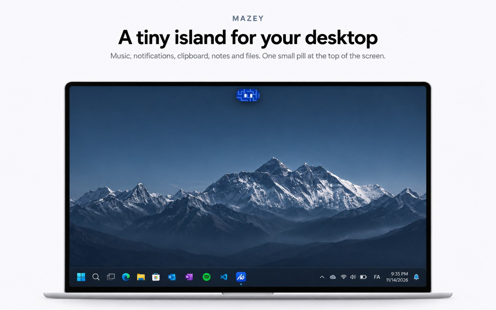

<div align="center">

# مازی

یک جزیرهٔ کوچک برای ویندوز. بالای صفحه می‌نشیند، آهنگ را نشان می‌دهد، نوتیفیکیشن می‌گیرد، کپی را یادش می‌ماند و فایل نگه می‌دارد.

برای بچه‌های [گروه آموزشی ماز](https://biomaze.ir).



[](https://drive.google.com/file/d/1riPni94hQKUKCWCEN-Y7DfGRPL1U7lM1/view)

[نسخه کم‌حجم](https://drive.google.com/file/d/1riPni94hQKUKCWCEN-Y7DfGRPL1U7lM1/view)
·
[کیفیت بالا](https://drive.google.com/file/d/1ACKwnljfAUrI4QhF9cY_hFoMD-xLoUmT/view)
·
[فصل‌ها](docs/guide/README.md)

</div>

<div dir="rtl">

## دانلود — نسخه ۱.۰.۶

فایل‌ها در [Releases](https://github.com/irariamir/Mazey/releases/latest) هستند. **Latest** الان ۱.۰.۶ است.

- **[Mazey-Setup.exe](https://github.com/irariamir/Mazey/releases/latest/download/Mazey-Setup.exe)** — نصب معمولی. فقط همین کاربر، بدون Admin. بیشتر افراد همین را بردارند.
- **[Mazey-Portable.exe](https://github.com/irariamir/Mazey/releases/latest/download/Mazey-Portable.exe)** — نصب نمی‌خواهد؛ مستقیم اجرا می‌شود.
- **[Mazey-Windows.zip](https://github.com/irariamir/Mazey/releases/latest/download/Mazey-Windows.zip)** — خودِ برنامه داخل زیپ.

ویندوز ۱۰ یا ۱۱، با WebView2 (روی ویندوز ۱۱ هست). اگر SmartScreen آمد: More info → Run anyway.

## امکانات

- پخش موزیک: اسم، کاور، قبلی و بعدی. فیلم و بازی تمام‌صفحه را ول می‌کند.
- نوتیفیکیشن یک خط. بزن، همان چت باز می‌شود.
- کپی هوشمند: لینک، حساب، تاریخ شمسی و میلادی.
- فایل را روی جزیره رها کن؛ همان‌جا می‌ماند.
- یادداشت سریع با `Ctrl+Alt+N`. اگر زمان توی متن باشد، یادآور می‌شود.
- رمز می‌سازد و با حساب ویندوز قفل می‌کند.
- خواندن متن صفحه با `Ctrl+Alt+T`. فارسی و انگلیسی.
- تایمر درس تا آخر روی صفحه می‌ماند.
- دکمهٔ ماز یک جمله می‌گوید و بعد از حدود ۱۰ ثانیه می‌رود.
- تم پیش‌فرض اورست است. تم آریامیر هم هست.
- نقطه وقتی میکروفون یا دوربین روشن است؛ خط وقتی نت یا VPN عوض می‌شود.

## حریم خصوصی

به اینترنت وصل نمی‌شود، مگر برای دیدن نسخهٔ جدید همین ریپو. آن را هم می‌شود خاموش کرد. نوتیفیکیشن و رمز و کپی روی سیستم خودت می‌مانند.

## سازنده

من آریامیرم؛ دانش‌آموز پایه دوازدهم رشته ریاضی هستم. برنامه‌نویسی و ساختن محصول را دوست دارم.

برای من کد فقط نوشتن نیست؛ می‌خواهم ایده به چیزی تبدیل شود که بقیه واقعاً استفاده کنند. مازی را همین‌طور ساختم تا کار با ویندوز کمی ساده‌تر و قشنگ‌تر باشد.

هنوز اول مسیرم. از ساختن دست نمی‌کشم.

[ariamir.ct.ws](http://ariamir.ct.ws) · [@Ariamir_academy](https://t.me/Ariamir_academy) · [@ariamir_ir](https://t.me/ariamir_ir)

## ساختن

Rust و NSIS لازم است. از ریشهٔ ریپو:

```
cd src-tauri
cargo build --release
cd ..
makensis /DVERSION=1.0.6 installer/island.nsi
```

هر پوش روی [Actions](.github/workflows/build.yml) بیلد می‌شود. تگ `vX.Y.Z` ریلیز می‌کند.

مجوز [MIT](LICENSE). Tesseract فارسی داخل برنامه است (Apache 2.0).

</div>
